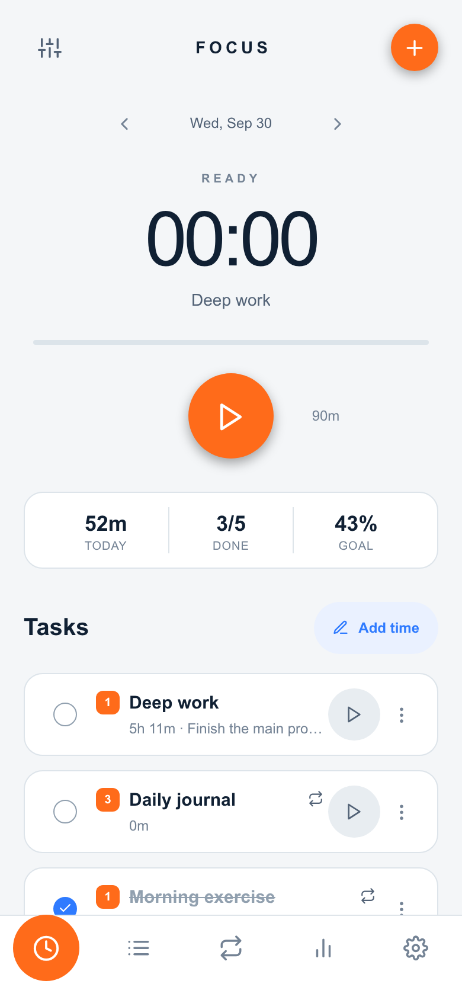
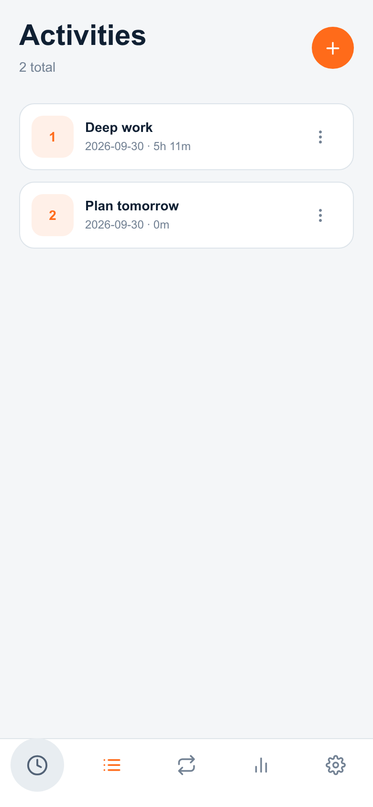
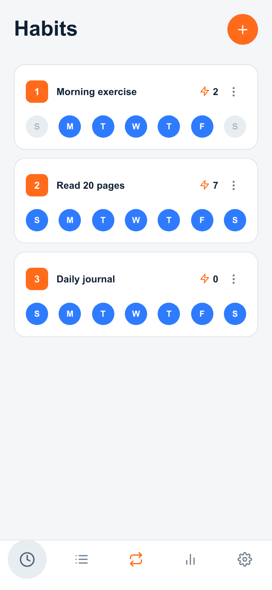
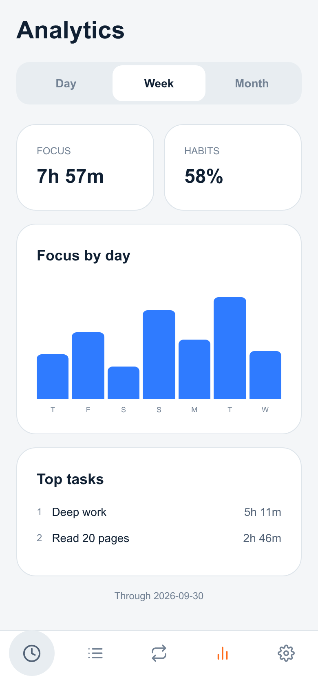
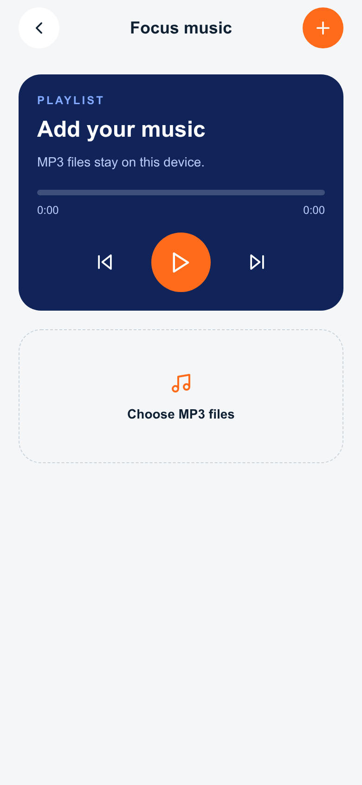
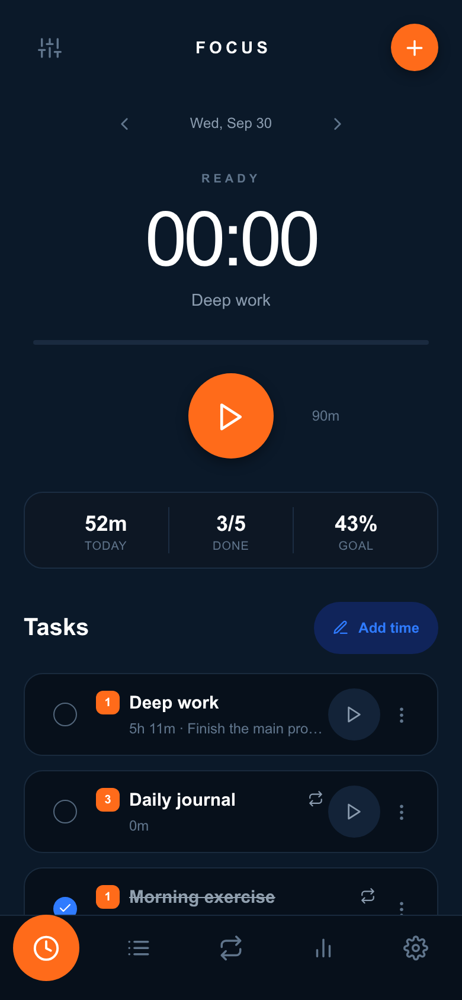
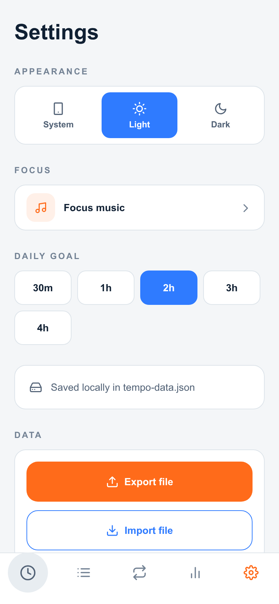

# Tempo

<p align="center">
  <strong>A calm, local-first task and habit timer built with Expo.</strong>
</p>

<p align="center">
  Track focused work, build repeatable habits, add time manually, and understand where each day went.
</p>

<p align="center">
  
</p>

## Features

- **Reliable focus timer** — start, pause, resume, and finish a session without timer drift. Running sessions survive app restarts.
- **Daily activities** — create one-off tasks for a date, set a priority and estimate, and attach an optional note.
- **Recurring habits** — choose repeat weekdays, mark daily completions, and follow completion progress and streaks.
- **Flexible task actions** — use each task's menu to add time, convert between an activity and habit, edit, or delete.
- **Manual time entry** — record work after the fact with a date, start time, and duration.
- **Day, week, and month analytics** — review focused time, top tasks, daily bars, and habit completion rates.
- **Local focus music** — import MP3 files and control an on-device playlist while working.
- **Light, dark, and system themes** — choose an appearance that follows your preference.
- **Private local storage** — tasks, sessions, habits, settings, and timer state stay on the device.
- **Portable backups** — export all app data to a JSON file and import it later.

## Screenshots

<table>
  <tr>
    <td align="center"><strong>Today</strong></td>
    <td align="center"><strong>Activities</strong></td>
    <td align="center"><strong>Habits</strong></td>
  </tr>
  <tr>
    <td></td>
    <td></td>
    <td></td>
  </tr>
  <tr>
    <td align="center"><strong>Analytics</strong></td>
    <td align="center"><strong>Focus music</strong></td>
    <td align="center"><strong>Dark mode</strong></td>
  </tr>
  <tr>
    <td></td>
    <td></td>
    <td></td>
  </tr>
</table>

<details>
  <summary><strong>Settings and local backup</strong></summary>
  <br />
  
</details>

## How the timer stays accurate

Tempo stores timestamps instead of incrementing a counter every second. The visible clock is calculated from the saved start time, previously accumulated time, and the current time. This keeps a session accurate when the app is backgrounded and lets an active timer resume after a restart. Only one task can run at a time.

Focus music uses Expo Audio background playback on Android and iOS. Android displays media playback as a foreground service while music is playing, allowing playback to continue when the screen is locked or another app is open.

## Tech stack

| Area | Technology |
| --- | --- |
| App | Expo 57, React Native 0.86, TypeScript |
| Navigation | Expo Router |
| Styling | NativeWind 4 / Tailwind CSS |
| State | Zustand |
| Persistence | AsyncStorage and Expo FileSystem |
| Audio | Expo Audio |
| File workflows | Expo Document Picker and Expo Sharing |
| Tests | Node test runner and TypeScript |

## Project structure

```text
app/
  (tabs)/          Today, Activities, Habits, Analytics, Settings
  task/            Create and edit tasks
  session/         Manual time entry
  music.tsx        Local focus playlist
components/        Timer, task cards, forms, menus, data controls
hooks/             Theme and live clock hooks
lib/               Pure timer, analytics, backup, date, and file helpers
store/             Persisted Zustand stores
types/             Task, session, timer, and music types
tests/             Logic and persistence regression tests
```

## Run locally

Requirements: Node.js, npm, and a recent Expo Go version compatible with Expo SDK 57.

```bash
git clone <your-repository-url>
cd TaskTimerApp
npm install
npm start
```

Scan the QR code with Expo Go while the phone and development machine are on the same network. You can also run a platform directly:

```bash
npm run android
npm run web
```

## Build an Android APK

For a cloud build, configure an Expo account and run:

```bash
npx eas-cli build --platform android --profile preview
```

For a fully local build, install Java 17 and Android SDK 36, generate the native project, and run Gradle:

```bash
npx expo prebuild --platform android
cd android
./gradlew assembleDebug
```

The debug APK is written to `android/app/build/outputs/apk/debug/app-debug.apk`.

## Quality checks

```bash
npm run lint
npm run typecheck
npm test
npm run build:web
```

## Data and privacy

Tempo has no backend, accounts, analytics service, or cloud database. App data and imported music remain on the device. JSON backup export is user initiated. Clearing app storage or uninstalling the app removes local data unless a backup was exported first.

## License

Tempo is available under the [MIT License](LICENSE). Third-party packages remain subject to their respective licenses.
